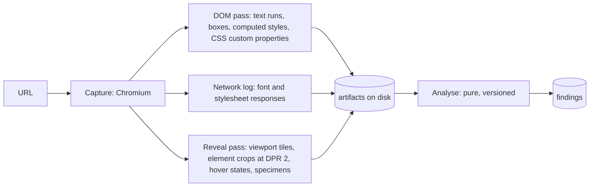
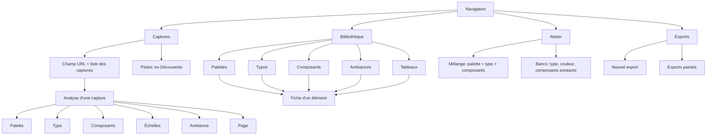

# DRD redesign: specification

Status: design phase, 2026-09-30. No application code changed in this phase.
Build and review follow; nothing reaches asi0 before a ship verdict.

Mockups: [`docs/redesign/`](redesign/) (HTML sources plus PNG at 968 × 875 and
412 × 915). Before-state screenshots of the current app: [`docs/redesign/before/`](redesign/before/).

Reading order for the build agent: §1 (why), §4 (what we extract), §5 (what
the libraries do), §7 (the proof list you will be held to), §9 (the slices).

---

## 1. What DRD is for

**Register:** product (an authenticated tool; design serves the task).

**User.** asi0, alone, mostly on a Galaxy Fold: inner screen 968 × 875 CSS px,
cover screen 412 × 915. He meets a site he likes, often on the phone, and wants
to keep *the specific thing* he likes about it: "this site has a palette I
like", "that serif and its scale", "these buttons". Later he, or an agent he
briefs (Brunel, the site-building persona), builds a client site from a mix of
those kept things.

**Job.** Capture a page, see its design decomposed into typed, reusable parts,
keep any part in one tap into a typed library, say why, and hand a clean mix
of parts to an agent or a codebase.

**What success looks like.** asi0 opens a capture on his phone, and within
30 seconds has the palette and the type pairing he liked in his libraries,
each with a reason. A month later he searches "serif chaud", filters by a teal
hue, picks three items from three sites and exports a Tailwind theme plus an
agent brief that says what to take from each and why.

**Principles** (hypothesis for a future PRODUCT.md; the impeccable `init`
interview was not run because asi0 is not in the loop during design):

1. *Measured, not guessed.* Every value shown comes from the browser that
   rendered the page or from its pixels, and says which, with a confidence.
2. *The captured site is the only colour on screen.* DRD's own chrome is
   achromatic so it never tints the judgement of someone else's palette.
3. *Keeping is one gesture; explaining is one more, right after.* The reason
   stays the most valuable field, but it no longer blocks the keep.
4. *Typed first, free second.* Palettes, type, components and moods each get a
   library that knows how to show, search and export that type. Boards are the
   free, cross-type layer on top.
5. *Mix, never clone.* Exports keep the anti-copy rules the current packs
   already enforce.

---

## 2. Audit of the current app

Method: read `README.md`, `docs/DEPLOY.md`, `docs/THREAT-MODEL.md`,
`server/capture/*`, `server/db.ts`, `server/routes/library.ts`,
`server/export/pack.ts`, `src/main.ts`, `src/views/{capture,save,collections}.ts`;
queried the live database read-only; ran an isolated copy of the app (copied
`data/`, port 5791, throwaway account) and captured it at 968 × 875 and
412 × 915 in Chromium.

### 2.1 What exists and is worth keeping

- The capture containment (URL guard, DNS pinning, per-request re-checks,
  no captured HTML to the client). Untouched by this redesign.
- Server-side Chromium measuring real boxes and computed styles
  (`server/capture/extract.browser.js`). The right foundation; the analysis on
  top of it is what is weak.
- The `why` as a first-class column, provenance assembled server-side, the
  anti-copy pack rules (single-host refusal, under-3-sources warning).
- Node-only stack (node:http, node:sqlite, puppeteer), PWA with offline read
  cache, self-hosted fonts, strict CSP (`server/http.ts:112-123`).

### 2.2 What is weak (evidence)

Live data at audit time: 5 captures (2 ready, 3 failed), 193 extracted
elements, 2 saved references, 2 collections, 0 packs.

| # | Weakness | Evidence |
|---|---|---|
| W1 | Capture fails often. | 3 of 5 captures failed: `Protocol error (Page.captureScreenshot): Unable to capture screenshot` (mamielasagnes.fr), `Navigation timeout of 25000 ms exceeded` (nematis.com), `Capture interrompue après 60 s.` (creamontblanc.org). Being fixed now by DrdCapture in `server/capture/runner.ts`. |
| W2 | The full-page screenshot misses scroll-revealed content. | `media/3d95c4a1…/page.jpg` (maisoncyrah.fr, 1280 × 4755) is blank from y ≈ 2350 to ≈ 4200. The pipeline scrolls in 90 ms steps, jumps back to the top, then shoots (`runner.ts:225-237`), with `prefers-reduced-motion: reduce` emulated (`runner.ts:206`). |
| W3 | Crops are missing or blank. | 58 of 193 elements have a crop: button 30/65, image 22/51, hero 4/14, card 0/18, nav 0/11, grid 0/11, type 0/20. `maxCrops` is 28 per capture (`config.ts:57`) and buttons/images are cropped first (`runner.ts:286`). The first crop that exists, `el-0.png` ("VOIR TOUTES LES PRESTATIONS", 337 × 56), is a uniform off-white (pixel range 248/246/240 on every channel): it was re-shot inside the blank band of W2. |
| W4 | Colours are counted by element, not by what you see. | `#f8f6f0`, the page background of maisoncyrah.fr, is counted **1**; a pixel spike (§4.2) measures it at **37.7 %** of the page. `#1d1e20` is counted 93 because every ancestor with text adds one (`extract.browser.js:104-124`). On linear.app the page background `#08090a` is counted 13 as "text" while it covers **67.1 %** of pixels, and a lime card at 1.5 % of the page never appears in the DOM top 18. Colours are hex only; gradients, SVG fills and alpha < 0.08 are dropped (`extract.browser.js:49-62`). No OKLCH, no roles beyond "most frequent use", no contrast. |
| W5 | Font samples are script source; fonts are counted per ancestor. | Stored samples: `((e,t,n,r,i,a,o,s)=>{let c=document.documentElement…` (linear.app) and `astro-island,astro-slot,astro-static-slot{display:contents}…` (maisoncyrah.fr). `text(el)` is `textContent` (`extract.browser.js:24`), which includes `<script>` and `<style>` descendants. |
| W6 | Declared font is reported, rendered font is not. | maisoncyrah.fr headings declare `"PT Serif", "Playfair Display", serif` (element styles, 64/40/28 px, weight 600). The glyphs in the screenshot look like Playfair Display [INFERENCE: visual, high-contrast didone], so PT Serif is probably not loaded and DRD lists the wrong family first. No font source (Google Fonts, Adobe, self-hosted) is recorded. |
| W7 | No type scale, spacing scale, radius scale or component tokens. | The capture stores flat per-element style strings (`capture_elements.styles`); nothing groups them into a scale or a component. |
| W8 | Region labels are class names. | List view rows read `image__image`, `svg`, `block-header-cart__but…` (screenshot kept out of the public repo, §2.3). |
| W9 | On the phone, navigation buries the content. | `before/capture-412-top.png`: the section rail stacks above every page, about 500 CSS px of navigation before the capture title. |
| W10 | The image overlay is unusable. | Every region is tinted and nested boxes stack; on a 1280 px page scaled into ~740 px the tap targets overlap (screenshot kept out of the public repo). |
| W11 | Saving is a 6-field form. | `src/views/save.ts:56-100`: type, title, what, why, tags, collection, every time. The two real saved references (palette and fonts of linear.app) have empty `what` and `why`: the form was skipped, which defeats its purpose. |
| W12 | Saved items do not own their media. | `refs.image` points into the capture's media folder (`routes/library.ts:263,300`); deleting a capture strips every reference of its visual (confirm copy in `views/capture.ts:84`). |
| W13 | Collections are a single-membership tree with no search. | `refs.collection_id` (one collection per reference), nesting to 6 levels, no search, no filter (`before/collections-968.png`). |
| W14 | Palette display hides information. | Swatches have no label, the hex is in a `title` tooltip, a white swatch has no edge and disappears (`before/capture-412-top.png`). Fonts are listed by name with no specimen. |
| W15 | Exports are positional, not semantic. | `tokens.css` emits `--drd-<ref>-color-1: #f7f8f8` by index (`export/pack.ts:240-246`). No DTCG JSON, no Tailwind theme. |
| W16 | Mixed-language UI and generic look. | Playground labels are English ("Display face", "Body face", "Sample content", `before/playground-968.png`); the shell is system-ui on tinted paper with bordered boxes everywhere, the "template" look asi0 does not want. |
| W17 | Discovery is empty and disconnected. | `before/discovery-968.png`: no candidate; it is a top-level section with nothing in it. |

### 2.3 A note on the public repository

`Asi0Flammeus/drd` is **public** (`gh repo view` → `PUBLIC`). Screenshots of
third-party sites are private reference material (`THREAT-MODEL.md:115-118`),
so the before-shots that show captured pages (inbox thumbnails, image overlay,
region list) were taken but not committed. The mockups use values measured on
real captures (colours, sizes, ratios, font names) and a schematic page plan
instead of the captured pixels.

---

## 3. Research: what each tool contributes

| Tool | What it does well | What DRD takes |
|---|---|---|
| [Figma Dev Mode, inspect](https://help.figma.com/hc/en-us/articles/22012921621015-Guide-to-inspecting) | Select a layer, read its layout, colour, type, variables, and copy a generated code snippet; compare changes between versions. | The component inspector: crop, token table, copyable CSS snippet. Later: re-capture and compare. |
| [CSS Peeper](https://csspeeper.com/) | Palette grouped by purpose (backgrounds, text, borders), typography as a hierarchy, "locate every instance" of a style, bulk asset download. | Colours by **role**, not by frequency; **Localiser** (tap a colour or style, see every place it is used on the page). |
| [Coolors](https://coolors.co/) | Palette as full-height bands with values on them, lock and regenerate, contrast checker, exports (CSS, Tailwind, many formats), palette visualiser. | Band display with role and hex *on* the colour; per-pair contrast grades; one-tap copy per format; the Atelier preview. |
| [Fontjoy](https://fontjoy.com/) | Pairs as the unit, lock one face and vary the other, a similarity/contrast dial. | A **pair** (display + text) is a first-class type item; the Atelier lets you lock one kept face and try it against another. |
| [Mobbin](https://mobbin.com/explore/web/ui-elements) | A strict UI-element taxonomy (controls, views, overlays) and save to collections. | Component kinds are a fixed vocabulary (Bouton, Carte, Navigation, Hero, Formulaire, Pied de page, Champ, Badge), usable as a filter. |
| [Refero / Refero Styles](https://refero.design/) | Search by colour, typography, mood; a per-site style card; a `DESIGN.md` built for AI agents. | The capture's findings are that style card; the agent pack ships a `DESIGN.md`. |
| [Muzli search](https://search.muz.li/) | Filters by colour and style across a large feed. | Colour and style filters in the library search. The new-tab feed itself is out of scope. |
| [Pinterest](https://newsroom-archive.pinterest.com/en-gb/introducing-one-click-saving-for-the-web.html) | One-click save with a predicted board; board sections. | **Garder** saves at once to the typed library; a second tap picks a board, with the last used board first. |
| [Are.na](https://help.are.na/docs/getting-started/blocks) | A block connects to any number of channels; the trail shows where it lives. | An item belongs to many boards (many-to-many), and its detail shows every board it is in. |
| [Eagle](https://en.eagle.cool/support/article/search-by-color) | Search images by hue or hex, palette per asset, duplicate scan that merges metadata. | Hue/hex search across every kept colour; duplicate detection on keep, with merge that keeps both reasons. |
| [Dembrandt](https://www.dembrandt.com/dtcg) | Extracts a live site's design system to DTCG 2025.10, grades every contrast pair, emits a Tailwind `@theme` and a `DESIGN.md`. | Closest prior art for extraction and export; confirms the DTCG 2025.10 colour object (colour space plus components, hex only as fallback). |
| [DTCG 2025.10](https://www.designtokens.org/tr/2025.10/format/) | First stable design-token format (2025-10-28), OKLCH admitted as a colour space. | `tokens.json` follows it exactly. |

---

## 4. Extraction model

### 4.1 Pipeline

One capture produces **artifacts**; one analysis turns artifacts into
**findings**. The seam between them is the point of the design: the capture
needs a browser and the network, the analysis is a pure function over files
and can be re-run on old captures and tested on fixtures.



**Capture stages** (build on the DrdCapture fix; do not duplicate it):

1. *Load*: as today, behind the existing guard.
2. *Reveal pass*: scroll viewport by viewport with a 250 ms dwell and **without**
   reduced-motion emulation, so reveal-on-scroll content actually reveals.
   At each stop: grab a viewport tile (stitched later), sample a 24 px grid with
   `document.elementFromPoint` to record which element paints each point and
   its effective background (this is how area is measured, W4), and crop the
   components that are fully in view at DPR 2 (W2, W3). Fixed and sticky
   elements are recorded once, then hidden for the following tiles.
3. *DOM pass*: text is read from **own text nodes only**, skipping `script`,
   `style`, `noscript`, `template` (W5). Each text run records its element,
   computed font stack, size, weight, line-height, letter-spacing, transform,
   colour, effective background and glyph area (characters × size² × 0.5).
4. *Rendered fonts*: for one representative node per text style, CDP
   `CSS.getPlatformFontsForNode` returns the family actually used to paint the
   glyphs (W6). Puppeteer exposes CDP through `page.createCDPSession()`.
5. *Network pass*: font responses (URL host → source) and stylesheet text
   (parsed for `@font-face` blocks and `:root` custom properties). Custom
   property names are the site's own token names when it has them.
6. *Hover pass*: for up to 6 buttons and 6 links, `page.hover()`, re-read the
   computed style, crop again.
7. *Specimen pass*: for each rendered family × weight, inject a specimen node
   into the captured page (its own font is already loaded there), screenshot
   it to PNG, remove it. DRD keeps the picture, never the font file (open
   question 3).

**Analysis** reads the artifacts and writes findings in six kinds. Every value
shown in the UI carries its origin: `dom`, `pixels`, `declared` (a CSS custom
property), or `network`.

### 4.2 Palette

*Computed from both DOM and pixels.*

- **DOM usage.** Each colour gets weighted usages: background area (from the
  grid sampling), text glyph area, border length × width, and an
  *interactive* share (colours on `button`, `a`, `input`, `[role=button]`).
  Gradient stops and SVG fills/strokes count too; transparent layers are
  composited over the effective background before counting.
- **Pixels.** The stitched screenshot, downscaled to ≤ 200 k pixels, is
  clustered in OKLab with a deterministic k-means (k = 12, k-means++ with a
  fixed seed, 25 iterations), clusters closer than ΔE_OK 0.02 merged. Output:
  colour and share of page area.
- **Merge.** A DOM colour within ΔE_OK 0.03 of a pixel cluster is *confirmed*.
  DOM-only colours (hover states, rarely visible) are kept with lower
  confidence. Pixel-only colours that fall inside image boxes go to the
  **imagery palette** (§4.6), never the interface palette.
- **Roles** (first match wins, each colour once):
  - `Fond` (background): largest background area.
  - `Surface`: next background within ΔL 0.08 of the fond, ≥ 3 % area.
  - `Texte`: largest text share with contrast ≥ 4.5 on the fond.
  - `Texte 2`: next text colour ≥ ΔE_OK 0.05 from Texte, ≥ 5 % of text.
  - `Accent`: highest `chroma × interactive share`, chroma ≥ 0.04.
  - `Accent 2`: next such colour ≥ 30° hue or ≥ 0.15 L away from Accent.
  - `Bordure`: most used border colour not already assigned.
  - `État`: red/amber/green colours only when seen on elements whose class or
    ARIA says error, warning, success.
  - At most 8 roles; the rest collapse under "Autres couleurs vues".
- **Values.** OKLCH (L and C to 3 decimals, H to 0), hex fallback, area share,
  where used (element kinds), declared name if a custom property holds it.
- **Contrast pairs.** Only pairs that really occur (a text run's colour on its
  effective background; image backgrounds sampled from the screenshot behind
  the text box). Top pairs by text area, WCAG 2.x ratio with AA / AAA / large
  grades via `culori.wcagContrast`. APCA Lc shown as a secondary number only if
  the `apca-w3` licence is confirmed compatible during the build.

**Spike (run during this design, throwaway script, real screenshots):**

| Site | Pixel k-means (share, OKLCH) | Current DOM count |
|---|---|---|
| maisoncyrah.fr | 37.7 % `oklch(0.972 0.007 98)` (≈ `#f8f6f0`), 31.6 % white (includes the unrevealed band of W2), 10.2 % `oklch(0.449 0.067 201)` (≈ `#186063`), warm greys from photos 6.1 / 6.1 / 2.3 % | `#f8f6f0` counted 1, `#186063` counted 14 |
| linear.app | 67.1 % `oklch(0.140 0.005 262)` (≈ `#08090a`), 11.7 % `oklch(0.173 0.004 262)`, lime `oklch(0.918 0.201 114)` 1.5 % | `#08090a` counted 13 as "text"; lime absent |

Measured contrast on maisoncyrah.fr (WCAG 2): texte on fond 15.4, white on
accent 7.3, accent on fond 6.7, texte 2 on fond 7.0, white on the sand button
(`#c6b491`, "Explorer l'univers") **2.0, fails**. That last row is exactly the
kind of finding worth surfacing before an agent copies the button.

### 4.3 Typography

*Computed from DOM (styles, text runs), CDP (rendered family), network
(source) and pixels (specimens, real text crops).*

- **Text styles.** Runs grouped by (rendered family, weight, size rounded to
  0.5 px, line-height ratio to 0.05, letter-spacing in em to 0.005, transform,
  italic). Each style: glyph-area share, role guess (`display`, `h1`…`h3`,
  `corps`, `petit`, `label`, `bouton`, `nav`, `mono`) from tags and context,
  a real sample (own text, ≤ 60 chars) and a **crop of a real element** in that
  style. The crop is the honest specimen: it shows the site's own glyphs at the
  site's own size.
- **Families.** Declared stack, rendered family (CDP), generic class from the
  stack's last keyword (serif, sans-serif, monospace, cursive) for filtering,
  weights and italics seen, variable-axis settings if `font-variation-settings`
  is used, a raster specimen per weight (§4.1 step 7).
- **Source.** From font response hosts: `fonts.gstatic.com` → Google Fonts,
  `use.typekit.net` / `p.typekit.net` → Adobe Fonts, `api.fontshare.com` /
  `cdn.fontshare.com` → Fontshare, same site → auto-hébergée, other → the host.
  The UI says "licence probable: OFL" only for Google Fonts and Fontshare
  families and "à vérifier" otherwise.
- **Mismatch flag.** Declared first family ≠ rendered family → finding flagged
  "Police déclarée non chargée: PT Serif, rendue en Playfair Display" (W6).
- **Scale.** Body size = largest glyph share between 14 and 20 px. Fit every
  distinct size to `body × r^n` (integer n) over the named ratios 1.067, 1.125,
  1.2, 1.25, 1.333, 1.414, 1.5, 1.618; report the best ratio by its French
  interval name ("tierce majeure ≈ 1,25") with the mean relative error.
  Confidence *sûr* under 4 %, *probable* under 10 %, otherwise "échelle
  libre" with the sizes listed as-is. Line-height reported per step.
- **Pair.** When one family owns the display roles and another the body, emit a
  *pair* finding (Fontjoy's unit) in addition to the single families.

### 4.4 Components

*Computed from DOM (detection, tokens) and pixels (crops).*

- **Kinds**: Bouton, Lien-bouton, Champ, Carte, Navigation, Hero, Pied de page,
  Badge, Formulaire. Detection:
  - Bouton: `button`, `input[type=submit|button]`, `[role=button]`, or an `a`
    with its own background or border and horizontal padding ≥ 8 px or radius.
  - Carte: siblings sharing a structural signature (tag path + class stem),
    ≥ 3 in a row, with background, border, shadow or radius. Repetition is the
    signal; one boxed div is not a card.
  - Navigation: `nav`, `[role=navigation]`, `header` with ≥ 3 links.
  - Hero: first block starting in the first viewport that contains the `h1`
    and ≥ 40 % of viewport height.
  - Pied de page: `footer`, `[role=contentinfo]`.
- **Label**: accessible name, else own text, else the heading inside, else
  `Bouton 3` style ordinal. Never a class name (W8).
- **Tokens** (DTCG-shaped): background, foreground, border (width, style,
  colour), radius (4 corners), padding, height, gap, font (link to its text
  style), shadow list, transition (duration, easing), and a `hover` diff when
  the hover pass changed anything. Colours are resolved to palette roles when
  they match (ΔE_OK < 0.02), so a button reads "fond: Accent".
- **Crop**: in-view element screenshot at DPR 2 with 16 px of context, WebP,
  ≤ 1600 px tall; fallback cut from the stitched page. Every component has a
  crop or is dropped (W3). A dHash (64-bit) is stored for duplicates.
- **Grouping**: identical tokens collapse into one finding with "×7 sur la
  page" and all locations kept for Localiser.
- **Snippet**: a CSS rule generated from the tokens, copyable (Figma Dev Mode).

### 4.5 Spacing, radius, elevation

*Computed from DOM.*

- **Spacing**: paddings, margins and gaps (px) of layout elements, weighted by
  occurrence. Base unit b ∈ {2, 4, 5, 6, 8} maximising the share of values
  within ±0.5 px of a multiple of b; scale = most frequent multiples (≤ 10
  steps). Reported: "base 8 · 8 16 24 32 48 64 96", share explained.
  Also: dominant content width (most common width among wide centred blocks)
  and column count of the main grid when one exists.
- **Radius**: distinct values per component kind, then the system label:
  *droit* (all ≤ 2 px), *doux* (one soft value 8-16 px), *pilule* (999 px on
  controls), *mixte* with its rule ("boutons pilule, cartes 12 px").
- **Elevation**: distinct box-shadows, sorted by blur, each rendered on a
  neutral plate with DRD's own CSS (a value is a value, not a copyright).

Confidence: share of observed values the scale explains (*sûr* ≥ 80 %,
*probable* ≥ 60 %, else *à vérifier*).

### 4.6 Imagery and mood

*Computed from pixels inside image boxes; words derived from numbers.*

Per image (`img`, `picture`, CSS background images, `video` poster): its own
palette (k-means, k = 5), mean L, mean C, OKLab a/b means, L standard
deviation, distinct-colour count at 64 levels (few → aplat / illustration,
many → photo). Aggregated over the page into an **Ambiance** finding:

| Descriptor | Measure | Thresholds |
|---|---|---|
| Luminosité | mean L | < 0.40 sombre · 0.40-0.70 moyenne · > 0.70 lumineuse |
| Saturation | mean C | < 0.03 sourde · 0.03-0.08 mesurée · > 0.08 vive |
| Température | mean b (OKLab) | > 0.01 chaude · < -0.01 froide · else neutre |
| Contraste | L std-dev | < 0.12 doux · 0.12-0.22 moyen · > 0.22 marqué |
| Densité de page | share of page pixels within ΔE_OK 0.02 of Fond | > 55 % aérée · 30-55 % équilibrée · < 30 % dense |
| Nature | distinct colours per image | < 32 aplat · else photo |

The card shows 4 to 6 image crops, the imagery palette, the descriptors *with
their numbers*, and the page density. Confidence is *probable* by default:
the numbers are exact, the words are thresholds. If the optional LLM adapter
is configured, "Décrire l'ambiance" adds a sentence labelled as generated; the
export never depends on it (as today).

### 4.7 Page

The page itself stays a finding: title, description, language, theme-color,
favicon, dimensions, whether the CSS has `prefers-color-scheme: dark` rules
("Le site a un thème sombre", with a later "Capturer en sombre"), and a
`Garder la page` action (kind `page`, the old `site` type).

### 4.8 Confidence, shown the same way everywhere

| Level | UI | Rule of thumb |
|---|---|---|
| `sure` | filled dot, "sûr" | seen in two independent sources (DOM and pixels, or declared and DOM), or an exact computed value |
| `probable` | half dot, "probable" | one source, or a fitted scale with 4-10 % error, or a threshold word |
| `check` | empty dot, "à vérifier" | inferred (role by heuristic with a close runner-up, font mismatch, scale error > 10 %) |

Tapping the dot opens the evidence list ("vu dans le DOM : 214 éléments ; vu
dans les pixels : 18 % de la page"). Confidence is stored on the finding and
copied onto the kept item.

### 4.9 Finding shape

```ts
type Origin = "dom" | "pixels" | "declared" | "network" | "cdp";
type Confidence = "sure" | "probable" | "check";
type Oklch = { l: number; c: number; h: number; alpha?: number };
type Box = { x: number; y: number; width: number; height: number };

type Finding = {
  id: string;
  analysisId: string;
  kind: "palette" | "color" | "type" | "component" | "scale" | "mood" | "page";
  subkind: string | null;        // component kind, "spacing" | "radius" | "elevation", "family" | "pair" | "scale"
  title: string;                  // French, human
  confidence: Confidence;
  evidence: { origin: Origin; note: string }[];
  data: unknown;                  // per kind, below
  media: string[];                // blob hashes: crops, hover crop, specimens
  locations: Box[];               // for Localiser
  signature: string;              // duplicate key (§5.4)
};

type PaletteData = {
  colors: { role: string; value: Oklch; hex: string; share: number; usedOn: string[]; declaredAs?: string; origins: Origin[] }[];
  pairs: { fg: string; bg: string; wcag: number; grade: "AAA" | "AA" | "AA large" | "fail"; apca?: number; where: string }[];
  others: { value: Oklch; hex: string; share: number }[];
};
```

`TypeData`, `ComponentData`, `ScaleData` and `MoodData` follow §4.3 to §4.6
field for field; the build writes them next to the analysis code, not here.

---

## 5. Libraries and boards

### 5.1 Model

- **Item**: a kept finding, frozen at save time (data, media copied into the
  item's own blobs, W12). Kinds map to four typed libraries:
  - **Palettes**: `palette` and single `color` items (a colour is a one-colour palette in the library).
  - **Typographies**: `type` items (family, pair, scale).
  - **Composants**: `component` items, plus `scale` items (spacing, radius, elevation) under a "Échelles" filter.
  - **Ambiances**: `mood` and `page` items.
- **Board** (Tableau): a free, flat, cross-type set. An item can be in any
  number of boards (Are.na). Boards have a name, optional description, cover.
  No nesting: the current 6-level tree was used at depth 1 (two collections).
- **Why, what, tags**: `why` stays a column and is the most prominent editable
  field on every item. `what` is kept for migrated data and is optional.
  Tags are a join table, lower-cased, with suggestions from quick reasons.

### 5.2 One-tap keep (the central gesture)

1. Every finding carries a **Garder** button (44 × 44 px minimum, bookmark
   icon, label on wide screens).
2. Tap: the item is created immediately in its typed library with the
   finding's confidence and provenance. The button becomes **Gardé** (filled,
   inverted). No sheet opens.
3. A toast rises (6 s, paused while focused): "Gardé dans Palettes", with
   **Pourquoi ?** quick-reason chips specific to the kind, a one-line field,
   **Tableau…** and **Annuler**. Chips and field write to `why` (chips also
   become tags). Dismissing the toast is fine: the item exists, marked "sans
   raison".
4. Long-press or the chevron beside Garder opens the board picker directly
   (last used board first, then recent, then "Nouveau tableau").
5. Tapping **Gardé** again opens the item (not an unkeep; deleting is an
   explicit action in the item).

Quick reasons (French, per kind, editable in settings later):
Palette: "un seul accent", "fond chaud", "contraste doux", "retenue",
"accent audacieux", "sombre maîtrisé". Typo: "échelle nette", "caractère",
"lisibilité", "paire contrastée", "titres serrés". Composant: "tient au doigt",
"état visible", "rayon juste", "hiérarchie claire". Ambiance: "lumière",
"grain", "calme", "chaleur".

### 5.3 Items without a reason

"Sans raison" is a filter chip with a count, a line under the item in lists
("Sans raison. Toucher pour dire pourquoi."), and a pack warning. It never
blocks. (Open question 1 asks asi0 to confirm this trade.)

### 5.4 Duplicate detection

Checked on keep, server-side, against the user's items of the same kind:

| Kind | Near-duplicate when |
|---|---|
| Same finding | `finding_id` already kept → no new item; the button already shows Gardé |
| Palette | ≥ 80 % of colours matched one-to-one within ΔE_OK 0.02 (greedy on sorted L), same Fond and Accent roles |
| Colour | ΔE_OK < 0.02 |
| Type | same rendered family set, same body size, scale ratio within 0.02 |
| Component | same kind and dHash Hamming distance ≤ 6, or identical tokens |
| Mood | ≥ 50 % of image hashes shared |
| Capture | same normalised URL captured before → "Déjà capturé le 20/09 · Ouvrir · Recapturer" |

On a near-duplicate the item is still created (one tap must never fail), and
the toast says "Proche de « Linear » (Palettes)" with **Fusionner**: merge
keeps the older item, appends the new reason to `why`, unions tags and boards,
and records both sources in provenance (Eagle's merge). A "Doublons" line in
the item detail lists near-duplicates at any time.

### 5.5 Search and filter

- **Search** (one field, all libraries, accent-insensitive): SQLite FTS5 over
  title, why, what, tags, source host, family names, colour role names and
  component labels. Verified during design: Node 24.13's `node:sqlite` has
  FTS5, and the default tokenizer matches `lineaire` to `linéaire`.
  A query starting with `#` or `oklch(` is a colour query.
- **Colour filter** (Eagle, Muzli): a hue ring (tap or drag) or a pasted hex;
  returns items having a colour within ΔE_OK 0.06 (tunable), ranked by
  distance × share. Served from an `item_colors (item_id, l, a, b, share)`
  table with a bounding-box pre-filter, exact distance in JS.
- **Filters** (chips): library, board, source host, tag, "sans raison",
  confidence, light or dark (Fond L > 0.6), for type: serif / sans / mono /
  display; for components: kind (Mobbin vocabulary).
- **Sort**: récents, source, teinte (palettes by accent hue), taille.

### 5.6 Export

From any selection: one item, a multi-select, a board, or a filtered library.

| Format | File | Content |
|---|---|---|
| Design tokens | `tokens.json` | DTCG 2025.10. Colours as `{ "colorSpace": "oklch", "components": [l, c, h], "hex": "#…" }`; dimensions `{ value, unit: "px" }`; `fontFamily`, `fontWeight`, `typography`, `shadow`, `border` composites. Groups per source (`maison-cyrah.color.accent`) unless one item is exported (flat). `$description` carries the why; `$extensions["cat.alysis.drd"]` carries source URL, capture date, confidence. |
| CSS variables | `tokens.css` | `:root { --color-accent: oklch(0.448 0.068 199); … }` with role names, never positions (W15). |
| Tailwind v4 | `theme.css` | `@theme { --color-*; --font-*; --text-*` with `--text-*--line-height`; `--radius-*`; `--shadow-*`; `--spacing` set to the detected base unit `}`. |
| Agent brief pack | `drd-<name>.zip` | `BRIEF.md` (the ask, per-item what to take and why, the anti-copy rules, a pre-delivery checklist), `DESIGN.md` (overview, colours, typography, components, do and don't: the shape Refero Styles and Dembrandt ship to agents), the three token files, `pack.json`, `images/`, `README.md` with provenance. |

Export keys are English role names (`background`, `surface`, `text`,
`text-muted`, `accent`, `accent-2`, `border`) because they land in code; the UI
shows the French role labels. Per-item **Copier** gives CSS, Tailwind or JSON
of that item to the clipboard. The pack keeps today's rules: refuse a brief
from one host, warn under three hosts, warn on items without a reason.

---

## 6. Information architecture and navigation

Four destinations. Discovery folds into Captures; Collections become the
Bibliothèque; the Playground becomes the Atelier.



- **Phone (412 × 915, and any width < 700 px)**: bottom navigation bar, 4
  items, 56 px tall, icon + label, current item on a plate. Content is one
  column. The analysis shows findings first; the page is one row ("Accent
  localisé à 14 endroits") that opens a full-screen viewer with highlights.
- **Fold inner (968 × 875)**: left rail 88 px (icon + label). Analysis is a
  split: page plan or screenshot (300 px) on the left with live Localiser
  highlights, findings on the right. Library is list + detail pane (380 px).
- **Entry points to capture**: the URL field at the top of Captures; Android
  share sheet (Web Share Target in the manifest, `GET /share?url=&text=&title=`,
  the URL is taken from `url` or the first URL found in `text`); the existing
  `dnd.alysis.cat/https://…` shortcut.
- Hash routes: `#/captures`, `#/captures/:id/:tab`, `#/bibliotheque/:library`,
  `#/items/:id`, `#/tableaux/:id`, `#/atelier`, `#/exports`, `#/exports/:id`.
  Old routes (`#/inbox`, `#/collections`, `#/packs`, `#/playground`,
  `#/discovery`) redirect once to their new homes.

Screens (every one has loading skeleton, empty and error states):

| Screen | 412 | 968 |
|---|---|---|
| Captures | URL field, captures as rows (favicon plate, title, host, status, counts "6 couleurs · 5 styles · 24 composants"), Pistes strip | same, two columns of rows |
| Analyse | header, sticky tabs, findings | split: page pane + findings |
| Bibliothèque | search, library tabs, filter chips, rows | same + detail pane |
| Fiche | preview, why, tags, boards, provenance, copy, export, doublons | opens in the detail pane |
| Tableau | cover mosaic, mixed-kind grid | same, wider grid |
| Atelier | pick a palette and a typo from the libraries, preview a mini page, save as board | side-by-side pickers and preview |
| Exports | list, "Nouvel export" wizard (source, formats, warnings, files preview) | same |

---

## 7. Interactions (the build's proof list)

Each line is one user interaction, named. The review phase checks every one
at 968 × 875 and 412 × 915 on the real surface and records what it observed.

| # | Name | Interaction and expected observation |
|---|---|---|
| I-01 | Capturer une URL | Paste a URL in Captures, tap **Capturer**: a new row appears in state "Analyse…" with live stages (Chargement, Défilement, Mesure, Pixels, Terminé). |
| I-02 | Capturer par partage | From Chrome on Android, Partager → DRD: DRD opens on the new capture's progress. |
| I-03 | Capturer par raccourci | Open `dnd.alysis.cat/https://site.fr` signed in: the capture starts; signed out: login, then the capture starts. |
| I-04 | Suivre et réessayer | A failing capture shows the reason in French and **Réessayer**; retrying creates a new attempt without losing the old one. |
| I-05 | Changer d'onglet | Tap Palette, Typo, Composants, Échelles, Ambiance, Page: content swaps, the tab stays sticky, the URL hash updates, back returns to the previous tab. |
| I-06 | Choisir une couleur | Tap a band: it is outlined, the detail row shows role, OKLCH, hex, share, uses. |
| I-07 | Localiser | With a colour, text style or component selected, the page pane (968) or the full-screen viewer (412) outlines every location; the count matches the finding's. |
| I-08 | Copier une valeur | Tap a value (hex, OKLCH, size, token): it is copied; toast "Copié". |
| I-09 | Garder en un tap | Tap **Garder** on any finding: button turns **Gardé** at once; the item exists in its library (visible after navigating there). |
| I-10 | Dire pourquoi | In the keep toast, tap a quick reason and/or type: the reason is saved to the item and shown in the library row. |
| I-11 | Annuler | Tap **Annuler** in the toast: the item is gone from the library; the button returns to Garder. |
| I-12 | Ranger dans un tableau | Long-press Garder (or **Tableau…** in the toast): picker with last board first; choose or create: the item shows the board in its detail. |
| I-13 | Doublon proche | Keep a palette nearly identical to a kept one: toast names the neighbour; **Fusionner** leaves one item with both reasons and both sources. |
| I-14 | Inspecter un composant | Tap a component crop: sheet with default and hover crops, token table, CSS snippet, **Copier**, **Garder**. |
| I-15 | Lire un contraste | Contrast rows show sample "Aa" on the real pair, ratio, grade; a failing pair is marked "échec". |
| I-16 | Voir l'échelle typo | Typo tab lists styles as real crops with size / line-height / weight / tracking and the fitted ratio with its error. |
| I-17 | Chercher | Type "serif chaud" or "lineaire" in Bibliothèque: matching items across libraries, accents ignored. |
| I-18 | Filtrer par teinte | Pick a hue on the ring or paste `#186063`: items with a close colour, nearest first. |
| I-19 | Filtrer | Toggle "Sans raison", a source, a board, a type class, a component kind: the list and the counts update. |
| I-20 | Ouvrir une fiche | Tap a library row: detail with why (editable inline), tags, boards, provenance, confidence evidence, doublons. |
| I-21 | Sélectionner plusieurs | Enter selection, pick items: bar with **Ajouter au tableau**, **Exporter**, **Supprimer** (with confirmation). |
| I-22 | Créer et parcourir un tableau | Create a board, add items of different kinds, open it: a mixed grid with covers. |
| I-23 | Copier en CSS / Tailwind / JSON | From a fiche: each button puts the matching snippet on the clipboard; pasting shows valid CSS, a valid `@theme` block, DTCG JSON. |
| I-24 | Exporter un pack agent | Nouvel export → choose a board → formats → warnings (one host refused, < 3 hosts, missing reasons) → ZIP downloads with the files of §5.6. |
| I-25 | Composer dans l'Atelier | Pick a kept palette and a kept pair: the mini page re-renders with them; **Garder le mélange** saves a board. |
| I-26 | Réanalyser | On a capture analysed with v1: **Réanalyser** runs analysis v2 from stored artifacts, marked "analyse partielle" until recaptured. |
| I-27 | Supprimer une capture | Delete a capture after keeping items from it: the items keep their crops and specimens. |
| I-28 | Hors ligne | Airplane mode: Bibliothèque and fiches open from cache with "hors ligne · cache"; Garder is disabled with the reason. |
| I-29 | Accepter une piste | In Pistes, **Capturer** on a candidate starts a capture; **Écarter** hides the host. |

---

## 8. Visual direction for DRD

### 8.1 Scene and strategy

*asi0, on his Fold, mostly in the evening in a dim room and sometimes at a
desk by day, flicking through other people's sites to judge their colours
and type.* Dim light argues for a dark surround; judging colour argues for a
surround with **no hue at all** (a tinted frame shifts how every captured
swatch reads, which is why colour-critical tools sit on neutral grey). So:

- **Colour strategy: restrained to the limit. DRD has no brand hue.** The only
  chroma on screen belongs to captured sites. Primary actions and the kept
  state use inversion (paper ink on graphite), not a colour. Hue appears in
  DRD's own chrome only for errors (`oklch(0.68 0.17 25)`, text and icon, never
  a fill). This avoids the first reflex (a coloured accent on a dark tool) and
  the second (a "gallery" beige): the neutral is chroma 0, not warm, not cool.
- **Theme: dark first, light available**, following the system setting. Both
  are achromatic ramps of the same tokens.

### 8.2 Tokens

| Token | Dark | Light | Use |
|---|---|---|---|
| `--surround` | `oklch(0.185 0 0)` | `oklch(0.975 0 0)` | app background |
| `--mat` | `oklch(0.215 0 0)` | `oklch(0.945 0 0)` | panes, rows, the mat around captured content |
| `--plate` | `oklch(0.25 0 0)` | `oklch(0.915 0 0)` | current nav item, quiet fills |
| `--rule` | `oklch(0.33 0 0)` | `oklch(0.86 0 0)` | hairlines |
| `--ink` | `oklch(0.955 0 0)` | `oklch(0.2 0 0)` | text, primary |
| `--ink-2` | `oklch(0.82 0 0)` | `oklch(0.38 0 0)` | secondary text |
| `--ink-3` | `oklch(0.7 0 0)` | `oklch(0.5 0 0)` | tertiary text, metadata |
| `--mark` / `--mark-ink` | `--ink` / `--surround` | `--ink` / `--surround` | kept state, toast, primary button |

Contrast of text tokens (WCAG 2, computed for achromatic OKLCH as Y = L³):

| | on surround | on mat | on plate |
|---|---|---|---|
| dark ink / ink-2 / ink-3 | 16.4 / 10.7 / 7.0 | 15.4 / 10.0 / 6.6 | 14.0 / 9.2 / 6.0 |
| light ink / ink-2 / ink-3 | 16.8 / 9.3 / 5.6 | 15.4 / 8.5 / 5.1 | 14.1 / 7.8 / 4.7 |

Boundaries of controls whose edge is their only shape (unselected chips on the
light toast, text fields) use `oklch(0.62 0 0)` / `oklch(0.6 0 0)` to pass
3:1 non-text contrast; the first mockup draft at `oklch(0.75 0 0)` measured
1.95 and was corrected.

Spacing: 4, 8, 12, 16, 24, 32, 48. Radius, one documented rule: **captured
content 2 px** (plates, bands, crops keep their shape), **controls 8 px**,
**pills for chips and the Garder button**, **sheets 16 px**. z-index scale:
nav 20, sticky tabs 30, toast 40, sheet backdrop 50, sheet 60.

### 8.3 Type

**Recursive** (already self-hosted in `public/fonts/recursive.woff2`, OFL,
variable axes MONO 0-1, CASL 0-1, wght 300-1000, slnt, CRSV; verified with
fontTools). One family, two voices: *Sans Linear* (MONO 0, CASL 0) for the
interface, *Mono Linear* (MONO 1) for every measured value (hex, OKLCH, px,
ratios). Values and labels share a skeleton, so a table of measurements reads
as one voice, and it costs no new bytes. Fixed rem scale, ratio ≈ 1.2:
11 / 12 / 14 / 15 (phone body) / 17 / 20 / 24; weights 420 body, 520-560
labels, 600-640 titles; tabular figures for all numbers. The capture's own
fonts only ever appear as pictures (crops and specimens).

### 8.4 Signature components

1. **Bands**: a palette as full-height colour bands, role and hex printed on
   the colour in whichever of near-black or near-white passes (L > 0.6 → dark
   ink). Sharp 2 px corners. The selected band gets an inset double ring.
2. **Garder**: a pill with a bookmark icon; kept = inverted fill and filled
   icon. Motion: 180 ms background and colour, ease-out-quart; with reduced
   motion, instant.
3. **Keep toast**: inverted sheet with quick-reason chips and one field; it is
   the only light surface in the dark theme, which makes the moment legible.
4. **Contrast row**: "Aa" set in the real pair, ratio in mono, grade tag;
   failures in the error hue.
5. **Page pane with Localiser**: the captured page on a mat, locations outlined
   with an ink ring and a darkened halo.
6. **Plates**: crops and specimens sit on `--mat` with a 1 px `--rule`
   hairline, no shadow.

Icons: Phosphor (`@phosphor-icons/core`, MIT), regular weight, fill weight only
for the kept state; replaces the hand-drawn paths in `src/ui/controls.ts`.

Motion: 150-250 ms, ease-out-quart / quint, state changes only; View
Transitions API from a row to its fiche (crossfade under reduced motion);
skeletons, not spinners.

Anti-references: SaaS dashboard cards with coloured icons, a purple or teal
"brand accent" on a design tool, cream "gallery" backgrounds, glassmorphism,
generic bordered boxes everywhere (today's look, W16).

### 8.5 Mockups

| File | What it shows |
|---|---|
| `redesign/mockup-analyse-968.png`, `redesign/mockup-analyse-412.png` | Analyse of maisoncyrah.fr, Palette tab, the palette just kept, keep toast with a reason, contrast pairs, Localiser on the Accent. |
| `redesign/mockup-bibliotheque-968.png`, `redesign/mockup-bibliotheque-412.png` | Bibliothèque, Palettes library, three items (one without a reason), filter chips, detail pane with why, tags, boards, copy buttons and the Tailwind snippet. |
| `redesign/mockup-analyse.html`, `redesign/mockup-bibliotheque.html` | The HTML sources (responsive, open from the repo so the bundled Recursive loads). |

The page pane in the mockup is a schematic plan drawn from measured geometry
and colours, because the repo is public (§2.3); the app shows the real
screenshot there. Colours, ratios and sizes in the mockups are the measured
ones. The third palette row ("Sable + sarcelle", Radix Colors sand and teal)
stands for an item kept from the Atelier.

---

## 9. Implementation plan

### 9.1 Module shape

Three deep modules, each with a small interface and its tests at that
interface (see `skill://codebase-design` vocabulary):

- `server/analyse/`: `analyse(artifacts: CaptureArtifacts): Findings`. Pure;
  no database, no browser. Internals: `pixels.ts` (sharp adapter: decode,
  downscale, crop, dHash), `kmeans.ts`, `palette.ts`, `type.ts`,
  `components.ts`, `scales.ts`, `mood.ts`, `confidence.ts`. The capture runner
  writes artifacts; a job calls `analyse` and persists findings. Fixture tests
  feed recorded artifacts.
- `server/library/`: `keep(user, findingId, opts)`, `update`, `remove`,
  `search(user, query)`, board operations, `merge`. Owns items, blobs, tags,
  FTS rows, colour index, duplicate checks. No route writes these tables
  directly.
- `server/export/`: pure `toDtcg(items)`, `toCss(items)`, `toTailwind(items)`,
  `buildBrief(pack, items)`; the existing ZIP writer stays.

Client: keep Vite + TypeScript + the existing `h()` helper, no framework
(`README.md`: three dependencies by design; the UI needs native `<dialog>`,
popover, View Transitions and container queries, not a runtime). New
primitives in `src/ui/`: `bands`, `keep-button`, `keep-toast`, `sheet`,
`tabs`, `plate`, `contrast-row`, `confidence`, `hue-ring`, `nav`.

### 9.2 Dependencies

| Add | Why | Rejected alternative |
|---|---|---|
| `culori` (MIT) | OKLCH/OKLab conversion, `formatHex`, `formatCss`, `wcagContrast`, `differenceEuclidean("oklab")`, `clampChroma`; tree-shakeable via `culori/fn`; server and client. | chroma-js (no OKLCH-first API); hand-rolled matrices (the spike's formulas are fine for a spike, not for gamut clamping). |
| `sharp` (Apache-2.0) | Tile stitching, crops, WebP, raw pixels for k-means and dHash. Prebuilt for glibc x64, which matches the `node:24-bookworm-slim` image. | Chromium-only cropping (W3 shows why re-shooting fails); jimp (slow on 1280 × 12000). |
| `@phosphor-icons/core` (MIT) | SVG strings imported with Vite `?raw`; one icon family, no hand-drawn paths. | lucide (catalogue ranks it last). |
| `apca-w3` (conditional) | Secondary APCA Lc number. Add only after its licence is confirmed compatible. | none; WCAG 2 ratio is the grade either way. |

Written in-house because they are small and must be deterministic: seeded
OKLab k-means (~60 lines), dHash (~20 lines), scale fitting, role inference.
Rejected: `node-vibrant` (six fixed RGB swatch roles, not ours), `colorthief`
/ `quantize` (MMCQ in RGB, perceptually uneven), `image-q` (more than the
need). Font identification from pixels is not attempted: CDP gives the rendered
family exactly.

### 9.3 Data migration (keeps every existing capture and reference)

Migration 2, one transaction, preceded by the backup DEPLOY already documents
(`sqlite3 drd.sqlite ".backup …"`). `db.ts` migrations gain an optional
`up(connection)` step for data transforms next to the SQL.

```sql
CREATE TABLE blobs (hash TEXT PRIMARY KEY, mime TEXT NOT NULL, width INTEGER, height INTEGER,
  bytes INTEGER NOT NULL, created_at TEXT NOT NULL);           -- file: media/blobs/<ab>/<hash>.<ext>
CREATE TABLE analyses (id TEXT PRIMARY KEY,
  capture_id TEXT NOT NULL REFERENCES captures(id) ON DELETE CASCADE,
  version INTEGER NOT NULL, status TEXT NOT NULL, partial INTEGER NOT NULL DEFAULT 0,
  error TEXT, created_at TEXT NOT NULL, finished_at TEXT, UNIQUE (capture_id, version));
CREATE TABLE findings (id TEXT PRIMARY KEY,
  analysis_id TEXT NOT NULL REFERENCES analyses(id) ON DELETE CASCADE,
  kind TEXT NOT NULL, subkind TEXT, ordinal INTEGER NOT NULL, title TEXT NOT NULL,
  confidence TEXT NOT NULL, evidence TEXT NOT NULL DEFAULT '[]', data TEXT NOT NULL,
  media TEXT NOT NULL DEFAULT '[]', locations TEXT NOT NULL DEFAULT '[]', signature TEXT);
CREATE INDEX findings_analysis ON findings(analysis_id, kind, ordinal);
CREATE TABLE items (id TEXT PRIMARY KEY,
  user_id TEXT NOT NULL REFERENCES users(id) ON DELETE CASCADE,
  kind TEXT NOT NULL, subkind TEXT, title TEXT NOT NULL,
  why TEXT NOT NULL DEFAULT '', what TEXT NOT NULL DEFAULT '',
  data TEXT NOT NULL DEFAULT '{}', media TEXT NOT NULL DEFAULT '[]', cover TEXT REFERENCES blobs(hash),
  capture_id TEXT REFERENCES captures(id) ON DELETE SET NULL,
  finding_id TEXT REFERENCES findings(id) ON DELETE SET NULL,
  source_url TEXT, source_host TEXT, confidence TEXT, signature TEXT,
  provenance TEXT NOT NULL DEFAULT '{}', created_at TEXT NOT NULL, updated_at TEXT NOT NULL);
CREATE INDEX items_user_kind ON items(user_id, kind, created_at DESC);
CREATE TABLE item_tags (item_id TEXT NOT NULL REFERENCES items(id) ON DELETE CASCADE,
  tag TEXT NOT NULL, PRIMARY KEY (item_id, tag));
CREATE TABLE item_colors (item_id TEXT NOT NULL REFERENCES items(id) ON DELETE CASCADE,
  l REAL NOT NULL, a REAL NOT NULL, b REAL NOT NULL, share REAL NOT NULL);
CREATE INDEX item_colors_lab ON item_colors(l, a, b);
CREATE TABLE boards (id TEXT PRIMARY KEY,
  user_id TEXT NOT NULL REFERENCES users(id) ON DELETE CASCADE,
  name TEXT NOT NULL, description TEXT NOT NULL DEFAULT '', cover_item_id TEXT REFERENCES items(id) ON DELETE SET NULL,
  position INTEGER NOT NULL DEFAULT 0, created_at TEXT NOT NULL, updated_at TEXT NOT NULL);
CREATE TABLE board_items (board_id TEXT NOT NULL REFERENCES boards(id) ON DELETE CASCADE,
  item_id TEXT NOT NULL REFERENCES items(id) ON DELETE CASCADE,
  position INTEGER NOT NULL DEFAULT 0, added_at TEXT NOT NULL, PRIMARY KEY (board_id, item_id));
CREATE VIRTUAL TABLE items_fts USING fts5(item_id UNINDEXED, body);
```

The `up` step:

1. `refs` → `items`, **same ids** (so `packs.ref_ids` stay valid; the column is
   renamed `item_ids`). Kind map: `site` → `page`, `component` → `component`,
   `font` → `type`, `palette` → `palette`, `image` → `mood`. `what`, `why`,
   tags, provenance copied as-is. Palette payloads (`colors: [{hex,count,role}]`)
   are converted to the §4.9 shape with OKLCH computed and roles kept as
   given, confidence `check`. Font payloads drop the script-text `sample`
   (W5). Playground payloads keep their `css` / `ramp` / token tree untouched.
2. `refs.image` files are hashed and copied into `blobs`; the item's `cover`
   points at the blob (W12). Missing files are logged, not fatal.
3. `collections` → `boards`: the inbox collection becomes no board (its items
   simply have none); every other collection becomes a board named by its
   path joined with " › "; membership copied into `board_items`.
4. `item_tags`, `item_colors`, `items_fts` filled from the migrated rows.
5. `DROP TABLE refs; DROP TABLE collections;` (clean cutover; the old routes
   and views are removed in the same release).
6. Existing `captures`, `capture_elements`, `capture_links` stay: they are the
   v1 artifacts. A backfill job creates `analyses` version 2 with `partial = 1`
   from `page.jpg` plus `capture_elements.styles` (pixel palette, mood,
   component tokens without hover, no CDP fonts); "Recapturer" produces a full
   v2.

Test that earns its place (per the repo's rule, `README.md` "the invariants
worth pinning"): **migration 2 loses nothing**: a fixture database with refs of
every type, nested collections and a pack migrates to items with the same ids,
the same why/tags, a readable cover blob, the same board memberships, and a
pack that still resolves. Plus the pure `analyse` modules on two recorded
fixture artifacts (a light serif site and a dark sans site), asserting roles,
scale ratio and component count, not implementation details.

### 9.4 Build slices, in order

Each slice ships on its own and ends with its proof (interactions of §7).
Validation (typecheck, tests, build) runs once per slice by the integration
owner, not by parallel agents mid-flight.

| # | Slice | Contains | Proof |
|---|---|---|---|
| S0 | Capture reliability | DrdCapture's screenshot fix (in progress), then the reveal pass: tiles, grid sampling, in-view crops at DPR 2, no reduced-motion emulation during the pass. | Recapture maisoncyrah.fr: no blank band; every component has a non-uniform crop. I-01, I-04. |
| S1 | Data and library core | Migration 2 + `server/library` + items/boards/search/export-copy API; old refs/collections routes removed. | Migration test; API smoke on the copied production DB (2 refs → 2 items, 2 collections → 1 board). |
| S2 | Shell and design system | Tokens (§8.2), Recursive, Phosphor, nav rail / bottom bar, sheet, toast, tabs, keep button; new routes with redirects. | I-05 skeletons at both sizes; no horizontal overflow at 412 and 968; axe clean. |
| S3 | Analysis v2 | `server/analyse` (palette, type, components, scales, mood, page, confidence), artifacts from S0, backfill of v1 captures. | Fixture tests; I-26 on both existing ready captures. |
| S4 | Analyse screen | Tabs, bands, contrast rows, typo crops and scale, component grid and inspector, scales, ambiance, page; Localiser; Garder and the keep toast. | I-05 to I-12, I-14 to I-16. |
| S5 | Bibliothèque | Typed libraries, fiche, boards, search, hue filter, chips, multi-select, duplicates and merge. | I-13, I-17 to I-22, I-27. |
| S6 | Exports | DTCG, CSS, Tailwind v4, agent brief pack v2 with DESIGN.md; per-item copy. | I-23, I-24; `tokens.json` passes a DTCG 2025.10 validator; `theme.css` compiles under Tailwind v4. |
| S7 | Atelier | The three existing benches moved in, French labels (W16), the Mélange preview from kept items. | I-25. |
| S8 | Phone polish | Web Share Target, offline states for the new screens, Pistes inside Captures. | I-02, I-03, I-28, I-29 on the real phone. |
| S9 | Review | Every interaction of §7 at 968 × 875 and 412 × 915, pre-flight of `skill://impeccable`, a11y audit. | The ship verdict; only then a link to asi0. |

---

## 10. Open questions for asi0

1. **Garder puis pourquoi ?** The proposal saves in one tap and asks "Pourquoi ?"
   right after, never blocking; items without a reason are flagged and warned
   about at export. Today the reason is asked before saving (and was skipped
   both times it was used). OK to trade the forced reason for one tap?
2. **Les agents lisent-ils la bibliothèque directement ?** The plan exports a
   ZIP (tokens + BRIEF.md + DESIGN.md). Should Brunel and other agents also
   read boards live through a read-only API or MCP endpoint, or is the ZIP
   enough for now?
3. **Garder les fichiers de police ?** The plan keeps only pictures of a
   site's fonts (real text crops and specimens), never the font files. Storing
   the files would let the Atelier set live text in them, but most commercial
   webfont licences forbid that copy. Pictures only, or files too for
   Google Fonts / Fontshare (OFL) families?
